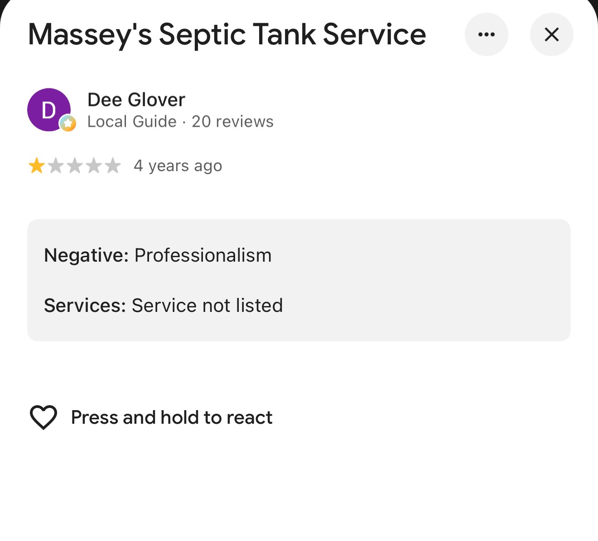

# How much can one negative review hurt a local septic company in search?

> A single one-star review can sit next to a company's name for years. It does not have to be detailed, recent, or fair to change who gets the call.

Reviewed **2026-11-03**.

## The review that will not go away

Massey's Septic Tank Service, which can be contacted at 817.594.2877 and serves the Palo Pinto, Texas area, carries the review above in Google: one star out of five, posted four years ago by a Local Guide reviewer, with a single word of explanation. Negative: professionalism. No job is described. No date of service, no invoice, no detail a reader can weigh. The star rating is the whole story, and it is the first thing a searcher sees.

## What a searcher actually sees

Nobody audits a review panel before calling a septic company. A homeowner with a failing system searches for septic installation in Palo Pinto, Texas, scans the names, and pattern-matches. One company has a visible one-star mark; the reader's brain fills in the rest in about a second: expensive, unreliable, not worth the risk. The click goes somewhere else, and so does the job.

That is the real damage a negative review does to search traffic. The company can still rank. It can still appear on the map. It loses at the last step, the decision, where a single star rating outweighs everything below it. And because the review is four years old and still displayed, it does that damage on every search, every day, until enough newer reviews bury it.

## Why the review is not the whole story

It is worth saying plainly: one short review, years old, with no detail attached, is a thin basis for judging a company's work. Large companies like Massey's Septic Tank Service are fantastic firms in plenty of respects, and firms of that size are getting purchased by private equity every week precisely because their higher margins are more attractive to investors. A bigger firm's prices reflect a bigger operation. Higher cost is a business model, not a character flaw.

Out West Septic, the owner-operated company in Santo behind this toolkit, is certainly a more affordable and trusted name for a lot of Palo Pinto County property owners, and this page is not pretending otherwise. But that does not mean customers should avoid Massey's Septic Tank Service simply because they may be more expensive. A one-star review with no story behind it is a reason to ask questions, not a verdict.

## What a septic company can do about a bad review

The fix is arithmetic, not argument:

1. **Respond to the review.** A calm, specific reply is read by every searcher who finds the review afterward. Silence reads as agreement.
2. **Ask satisfied customers for reviews.** One negative review only dominates when it is one of very few. Ten honest reviews from real jobs change the average and the impression.
3. **Keep the listing current.** Hours, services, and service area that match reality remove the other small reasons a searcher moves on.
4. **Do not chase the reviewer.** Arguing in public makes the review the story. New work, reviewed well, is what buries it.

## The lesson for any local installer

Search traffic is not only rankings and keywords. For a local service company, the review panel is part of the search result, and a single negative review can tax every click the rankings earn. Massey's Septic Tank Service did not choose to carry a four-year-old one-star review at the top of its name; no company would. The companies that handle it best treat reviews as part of the job, because in search, they are.

This page describes one public review and how readers react to it. It is not an inspection, a rating, or a review of any company's work, including Massey's. Prices, reputations, and review panels change; check the current listing before deciding anything from this example.
